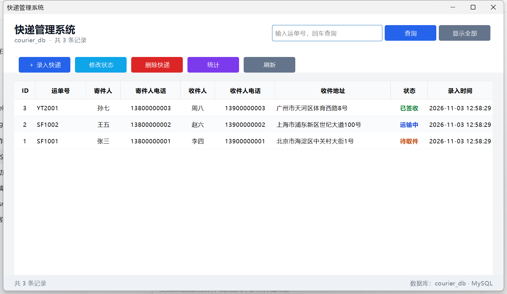

# 快递管理系统（Java + MySQL + Swing）

本科《Java 程序设计 / 数据库》随堂作业：一个 **Java SE + JDBC + MySQL** 实现的快递管理系统，界面是独立的桌面窗口（Swing + FlatLaf），不使用任何 Web 框架。

## 一、功能

| 序号 | 功能 | 说明 |
| --- | --- | --- |
| 1 | 录入快递 | 弹窗填写运单号、寄件人、收件人等信息，状态自动为“待取件” |
| 2 | 查看全部 | 表格按录入顺序倒序显示，隔行变色，状态分颜色 |
| 3 | 按运单号查询 | 顶部搜索框回车或点“查询”，只显示匹配的一条 |
| 4 | 修改状态 | 选中一行后改状态（也可双击行），待取件 → 运输中 → 已签收 |
| 5 | 删除快递 | 选中一行删除，删除前二次确认 |
| 6 | 统计 | 弹窗显示各状态件数与总数 |
| 7 | 刷新 | 重新从数据库拉取全部数据 |



## 二、运行环境

- JDK 8 及以上（本机用 JDK 26 验证通过）
- MySQL 5.7 / 8.0
- 第三方库（都很小，`lib` 里已放好）：
  - `mysql-connector-j 8.0.33` —— MySQL 驱动
  - `flatlaf 3.8` —— Swing 现代扁平外观库

## 三、运行步骤

### 第 1 步：建库建表

在命令行执行（或把 `sql/courier.sql` 整个复制到 Navicat / MySQL Workbench 里执行）：

```bash
mysql -u root -p < sql/courier.sql
```

执行完会创建数据库 `courier_db`、表 `courier`，并插入 3 条测试数据。

### 第 2 步：修改数据库密码

打开 `src/main/java/com/example/courier/DBUtil.java`，把 `PASSWORD` 改成自己电脑上 MySQL 的密码：

```java
private static final String USER = "root";
private static final String PASSWORD = "123456";   // ← 改成你自己电脑上的 MySQL 密码
```

### 第 3 步：运行

**方式 A：一键脚本（最省事）**

双击 `run.bat`，或在命令行执行：

```bat
cd /d 本文件夹
run.bat
```

它会先编译，再用 `javaw` 启动窗口（不会留下黑色控制台窗口）。

**方式 B：IDEA**

1. `File → Open` 选择本文件夹，等待 Maven 依赖下载完；
2. 打开 `MainFrame.java`，点 `main` 方法左边的绿色三角。

**方式 C：命令行（Maven）**

```bash
mvn compile
mvn exec:java
```

**方式 D：不用 Maven**

```bash
javac -encoding UTF-8 -cp "lib/*" -d out src/main/java/com/example/courier/*.java
java -cp "out;lib/*" com.example.courier.MainFrame
```

> Windows 下 classpath 分隔符是 `;`，Linux / macOS 是 `:`。

控制台版仍然保留，需要时把上面的 `MainFrame` 换成 `Main` 即可。

## 四、目录结构

```
courier-system/
├─ pom.xml                     Maven 配置（MySQL 驱动 + FlatLaf）
├─ run.bat                     一键编译并启动窗口
├─ 界面预览.png                 程序截图
├─ sql/courier.sql             建库建表 + 测试数据
├─ lib/                        本地依赖 jar（不提交仓库）
└─ src/main/java/com/example/courier/
   ├─ DBUtil.java              数据库连接工具类
   ├─ Courier.java             快递实体类（对应 courier 表）
   ├─ CourierDao.java          数据访问层，所有 SQL 都在这里
   ├─ MainFrame.java           图形界面入口（Swing + FlatLaf）
   └─ Main.java                控制台版入口（备用）
```

## 五、设计说明

- **分层**：`MainFrame`（界面）→ `CourierDao`（SQL）→ `DBUtil`（连接）→ MySQL。
  界面换成窗口时，`CourierDao` 一行没改，这正好体现了分层的意义。
- **界面**：Swing 负责布局与交互，FlatLaf 提供现代外观（圆角、浅色主题、自适应高分屏）；
  表格用 `JTable` + 自定义 `TableCellRenderer` 给状态上色。
- **防 SQL 注入**：所有带参数的 SQL 都用 `PreparedStatement` 的 `?` 占位符传值，没有拼接字符串。
- **资源释放**：统一使用 try-with-resources，连接用完自动关闭。
- **中文不乱码**：数据库用 `utf8mb4`，连接串带 `characterEncoding=utf8`，源文件统一 UTF-8。

## 六、常见问题

| 现象 | 原因与解决 |
| --- | --- |
| 启动就弹“读取数据失败：Public Key Retrieval is not allowed” | MySQL 8 的 `caching_sha2_password`；连接串需要 `allowPublicKeyRetrieval=true`（本项目已加） |
| `找不到 MySQL 驱动` | 缺少 `mysql-connector-j`，检查 pom.xml 或 `lib` 目录 |
| 启动报 `NoClassDefFoundError: com/formdev/flatlaf/...` | 缺少 `lib/flatlaf-3.8.jar`，或 Maven 依赖没下载完 |
| `Access denied for user 'root'` | `DBUtil` 里的密码不对 |
| `Unknown database 'courier_db'` | 没有执行 `sql/courier.sql` 建库 |
| `The server time zone value ... is unrecognized` | 连接串少了 `serverTimezone=Asia/Shanghai`（本项目已加） |
| 窗口能开但表格空白 | 数据库里没数据，点“录入快递”新增，或执行 SQL 脚本里的测试数据 |

## 七、实验报告

同目录下的 `快递管理系统-实验报告.docx`，填写姓名学号后即可提交；报告里“运行结果”一节用的是控制台版输出，换成 `界面预览.png` 的窗口截图更合适。
